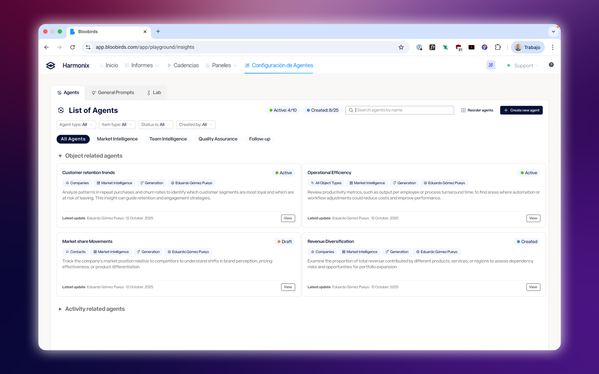
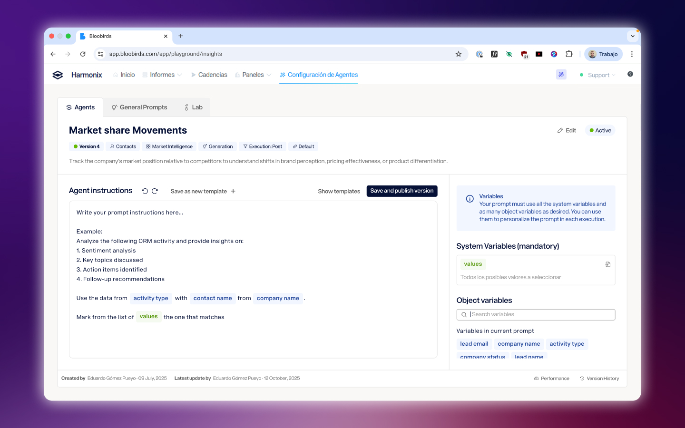
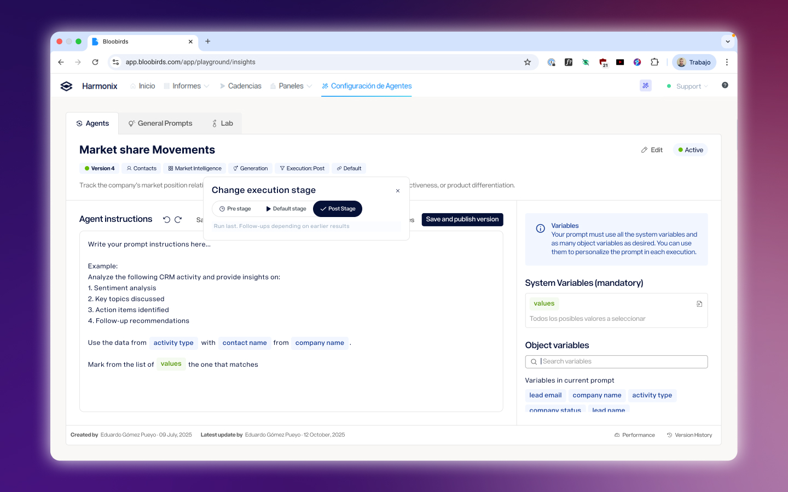
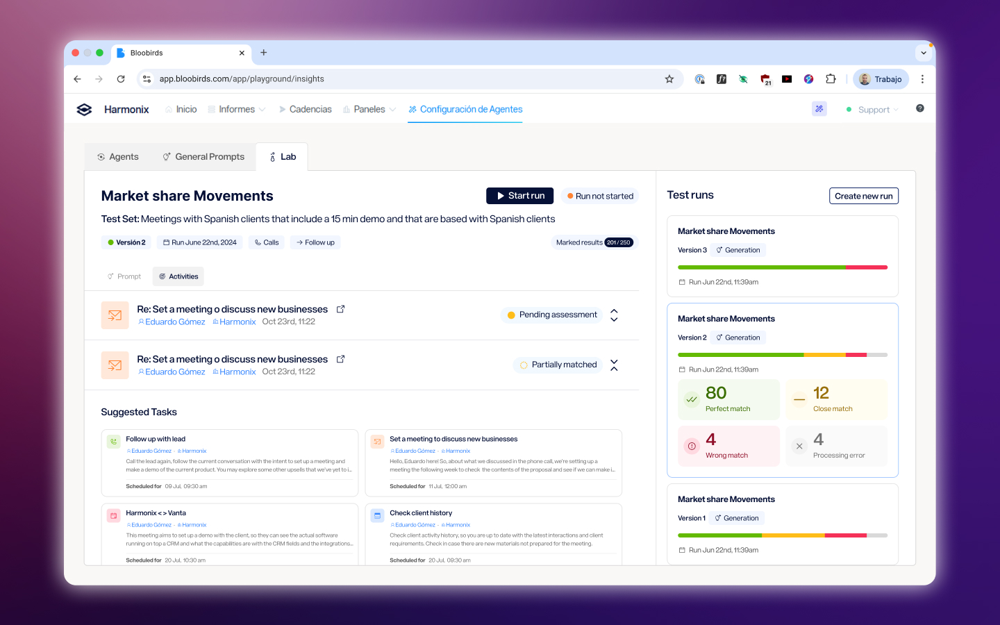
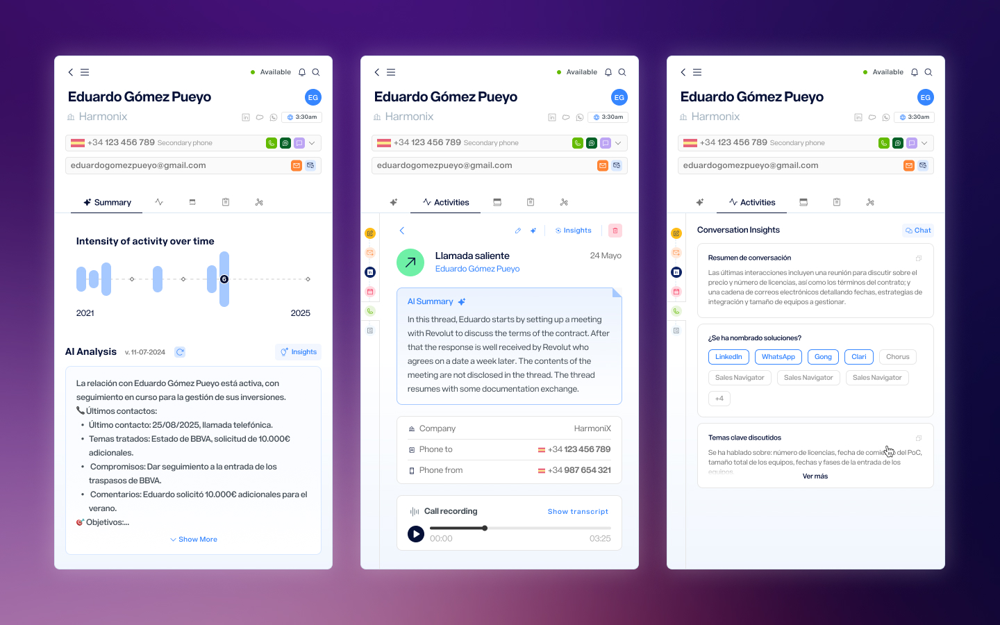

## Context

**Harmonix** is a tool that sits on top of users' existing CRM workspaces — Outlook, Salesforce, Dynamics, LinkedIn — and unifies their communication and information tools. It works primarily through a browser extension that adapts to the content of each web page, but it also includes a web application that serves as a control center: settings for administrators and personalization for each user (signature, default phone numbers, avatar...).

## The situation

Sales reps spend a significant part of their day in calls and meetings. After a one-hour conversation with a client, the work doesn't stop there: someone has to review the recording, extract what was discussed, identify next steps, flag what's going wrong in the relationship, and log all of it somewhere useful. Either you carve out time after the call to do it manually, or you take notes while the conversation is happening — which means you're not fully present in it.

Harmonix already transcribed and analyzed calls, but only our team could configure that analysis. The question was whether customers could set it up themselves.

## The challenge

The answer was yes — but only if we could make the configuration accessible. The underlying mechanism was genuinely technical: agents that read a transcript, extract specific information based on a structured prompt, inject variables from the CRM, and return an output in a defined format. Some agents also depended on others, waiting for a previous agent's output before running.

Exposing all of that to a non-technical user — a sales rep who just wanted to know if a client was at risk — was the central design problem. The variable system in particular took the most iterations: how to show what variables were available, how to let users insert them into a prompt without writing code, and how to communicate what would happen at runtime without overwhelming the configuration screen.

## Solutions

### A structured taxonomy of agents

Agents were organized by what they do — Decision, Generation, Assignment, Task Creation, Activity Tracking — and by what they operate on: calls, meetings, emails, companies, leads, and opportunities. This classification wasn't just organizational; it shaped what options appeared at each step of the configuration, reducing the decision surface for users who just needed to get something working.

### Making variables usable

The hardest part of configuring an agent is telling it what information to use. Variables pull live data from the CRM — contact details, previous interaction history, channel usage — and inject it into the prompt at runtime. The design challenge was making this feel like filling in a form, not writing a script. The final interface surfaced available variables contextually based on the agent type and the object it operated on, with a clear preview of how the prompt would look when populated.

### Agents that work together

More advanced use cases required agents that depended on each other — one agent waiting for another's output before running. We designed this dependency system to be explicit without being intimidating: users could see which agents fed into which, and configure the execution order without needing to understand the technical pipeline behind it.

### Testing before going live

Before activating an agent, users could test it against real past activities in the Lab — a sandboxed environment where outputs were generated but never surfaced to the rest of the product. This let users validate that an agent was doing what they expected without risk, and it reduced the back-and-forth between configuration and support that had been common with earlier internal versions.

### Closing the loop in the extension

Configuring agents happens in the web app, but the value lands in the extension — the place where sales reps are actually working. Agent outputs appear directly in the contact detail view, alongside the activity history, the call recording, and the communication tools. The result is that after a call ends, the rep opens the extension, and the analysis is already there: a summary, a decision on account health, next steps, or whatever agents have been configured to produce. The work of reviewing the call has already been done.

## Reflection

This project started as an internal tool for administrators and expanded, over the course of a year, into a feature that any user on the platform could configure and run. That progression was intentional — starting with a more controlled audience let us learn what the configuration experience needed to handle before exposing it more broadly.

The biggest ongoing tension was between power and approachability. The agent system could do a lot, but every additional capability came with more things to explain. The decisions that held up best were the ones that reduced what users had to think about at any given moment — not by hiding complexity, but by surfacing it only when it was actually relevant.