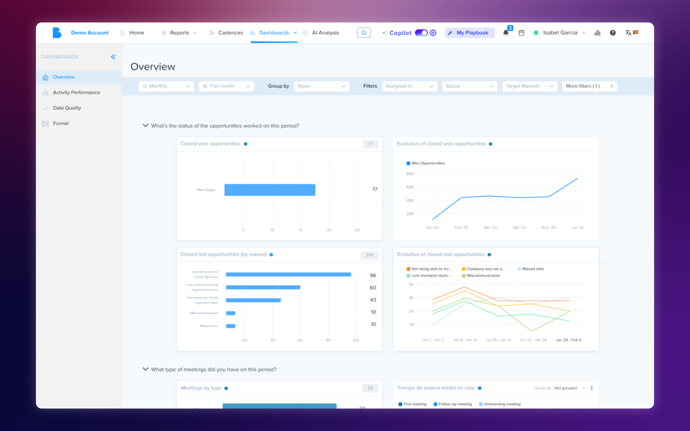

import ImageCarousel from '../../../components/ImageCarousel.astro';
import pipelinePanel from '../../../assets/case-studies/dashboards/pipeline-panel.jpg';
import aiDashboards from '../../../assets/case-studies/dashboards/ai-dashboards.jpg';
import searchViews from '../../../assets/case-studies/dashboards/search-views.jpg';

## Context

**Harmonix** is a tool that sits on top of users' existing CRM workspaces — Outlook, Salesforce, Dynamics, LinkedIn — and unifies their communication and information tools. It works primarily through a browser extension that adapts to the content of each web page, but it also includes a web application that serves as a control center: settings for administrators and personalization for each user (signature, default phone numbers, avatar...).

Within this web application there is a section dedicated to data analytics — the dashboards.

## The problem

The dashboards were built in the product's early stages and hadn't evolved with it. The original design followed a linear sales process that no current customer actually used, and split data by stages of that process instead of offering a unified view. On top of that, the extension had expanded its functionality over time — calls, AI agents, new activity types — but the dashboards didn't reflect any of that new data.

The result was an analytics section that showed information nobody asked for and hid the information everyone needed.

## What customers told us

The feedback was direct: customers told us the information we provided wasn't useful because it didn't answer the questions they were actually asking. They wanted to know how their teams were performing, what communication volume they were handling, how the AI agents they'd configured were working — not to see data organized around a sales funnel that didn't reflect the way they worked.

This feedback made it clear the problem wasn't cosmetic. It wasn't about rearranging charts or changing colors — it was about rethinking from scratch what data deserved to be there and how it should be presented. We decided that, having introduced new functionality in the extension, this was the ideal moment to rebuild the dashboards so they were actually useful.

From there, we maintained ongoing conversations with customers as we progressed through the new design, which allowed us to define three areas of improvement.

## Solutions

<ImageCarousel
  images={[
    { src: pipelinePanel, alt: "User view on current work pipeline" },
    { src: aiDashboards, alt: "Agent dashboards" },
    { src: searchViews, alt: "Search custom views" },
  ]}
  caption="Redesigned dashboards"
/>

### Separating content by category, not by process

Each tracking area — activities, AI agent performance, call monitoring — was given its own dedicated space, connected to the rest one click away. This separation by category, rather than by sales stage, allowed us to build specialized views for each page instead of forcing one system to serve every page and work well in none.

### Opinionated dashboards instead of build-your-own

We made the decision to have dashboard content curated by the team: users wouldn't build their own charts. The reason was practical — the variability that kind of freedom introduced was too large to maintain in a tool that wasn't dedicated to chart creation. Instead, we reviewed and selected the visualizations that offered the clearest view of each area, making sure the experience didn't feel like a limitation but like a decision that saved users work. That said, in some of the new screens users can view charts based on their custom fields and AI agents in a fully personalized way.

### Filters and saved views

The last area was providing tools so users could reach the data that mattered to them. This meant offering filters by team, person, and field, as well as ways to group information within charts. Calls by team? You can. Emails by whether they've been replied to or not? Also. The final piece was a views system where each filter configuration can be saved to return to later, supporting dynamic filters like date ranges.

## Reflection

The most interesting tension in this project was finding the balance between customization and scalability. Customers wanted to see their data their way, but building a completely open tool would have been unmaintainable and would have generated inconsistent experiences. The solution — curated dashboards with powerful filters and saved views — was a compromise that worked because we listened to what customers actually needed without losing sight of the fact that the product had to scale beyond any single customer.

This project also taught me the value of keeping customers close throughout the entire design process, not just at the beginning. The ongoing conversations while we designed allowed us to validate decisions before they became costly to reverse, and when the first users saw the result, their response confirmed we'd taken the right path.
