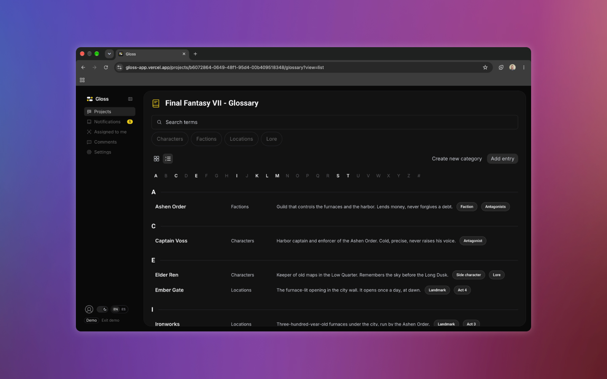
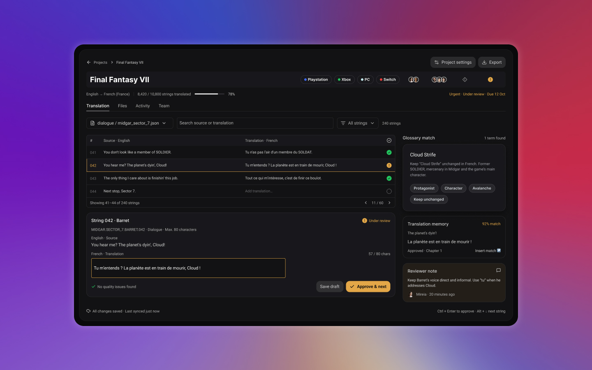
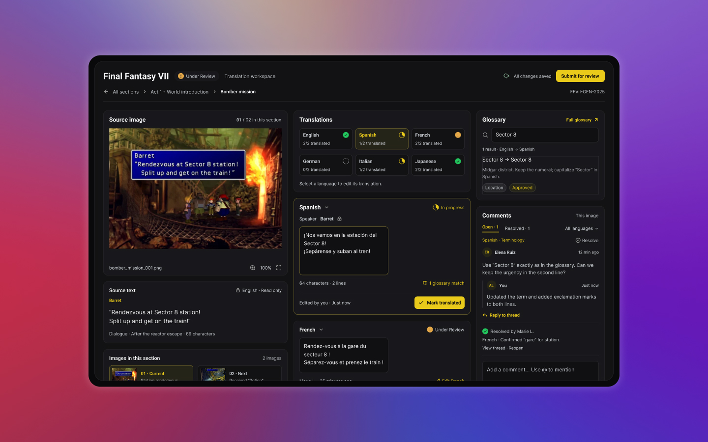
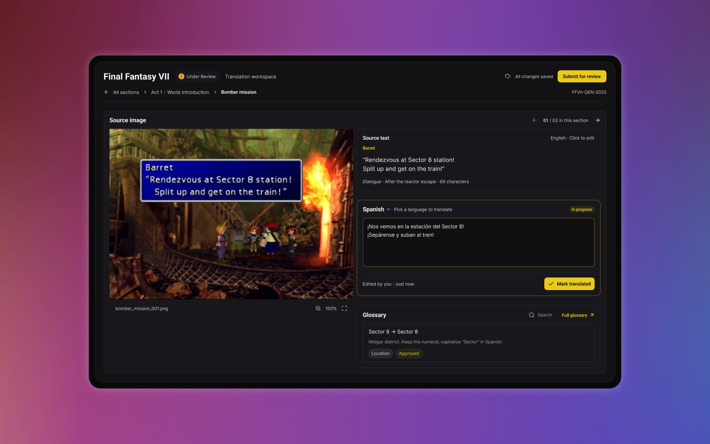
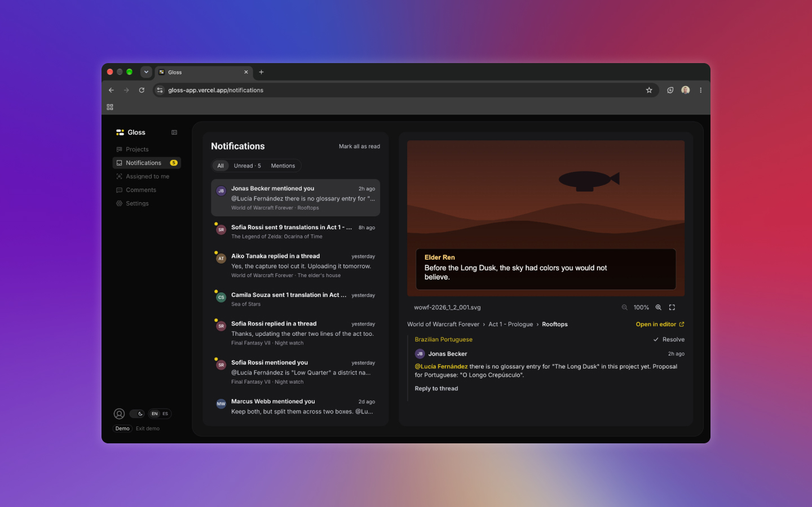

**[Try the live demo](https://gloss-app.vercel.app)** (press *Load demo* at the bottom left) · **[View the code on GitHub](https://github.com/EduardoGomezPueyo/gloss)**

## Why this project

I play a lot of games, and it still stings when a big release reaches Spain without a Spanish translation, like Square Enix's *Final Fantasy Tactics*. It's the same publisher whose *Dragon Quest* remakes got localizations that are better than a translation. The idea of a tool that helps translators do their best work kept pestering me, so I designed and built it to get it out of my head.

## The problem

Game translation suffers from three gaps: context, time and knowledge of the game's world. Lines often reach translators as rows in a spreadsheet, and without the scene a line can't be read the way the player will read it. The same words can be a joke, a threat or a goodbye.

## Three ideas in one place

- **The scene:** each line comes with the game image it belongs to. Text is read from the image automatically (OCR) and can be corrected by hand, with an *edited* mark.
- **The world:** a glossary per project (characters, factions, locations, lore), with matching entries shown right in the editor. It's also a way for the game's developers to give translators the best information possible.
- **Review:** translators submit their work and managers approve it or request changes. Threaded comments with @mentions live on each image and language, so developers can check translations and work with translators to improve the final product.

## The editor, three times

### 1. A table of strings

My first design was a string table, like the tools translators already use. It was efficient, but it repeated the problem: the line had no scene.

### 2. Image first, everything visible

So I put the image first: a three-column workspace with the scene, every language at a glance, the glossary and comments. It had everything, and that was the problem. Once it was built and I could use it, too many elements competed for attention.

### 3. Two columns, one language at a time

I redesigned it into two columns: the scene on the left, and the source text, one language at a time and the glossary on the right. The language cards became a picker, and the side-by-side comparison went away. Once built, comments found their place in a compact card under the image.

## Designing beyond the mockups

Five pages had no Figma design: Notifications, Assigned to me, Comments, and two Settings pages. I designed them in code. Each started as a short spec (content, actions, data) that I approved before building, reusing the components and tokens from the rest of the app. Before the release, I reviewed every designed screen against Figma, side by side.

## What I left out on purpose

- **AI translation: discarded, not postponed.** I don't like how AI gets used as a crutch instead of a tool, and I fear companies will use it to translate without checking the result. Gloss is built to help translators, not to replace them. The irony isn't lost on me: I built Gloss with an AI coding assistant. That's the difference I mean. I used it as a tool, and every decision went through me.
- **Translated text over the image.** The tool can't rewrite text inside a scene without the game's own font and text box, so it isn't worth faking.

## Building it as a designer

I wrote the spec and kept a decision log as I went: 49 decisions, each confirmed by me before it shipped. The app was built in ten phases and stayed usable after each one. Building it changed the design. Some decisions only became obvious once I could click through them, like the editor. Others came from constraints I'd never have found in Figma: the OCR couldn't read light text on dark dialogue boxes until we tested and tuned it on real-looking scenes. Gloss is open source and stores everything in the browser, and it's ready to plug in a real backend.

## Reflection

Designing and building the same product in three weeks changed how I design. The best decision in the project, simplifying the editor, came from using what I'd designed rather than looking at it. Next, I'd put it in front of real translators. No one has used Gloss yet, and the next round of decisions should come from them.
