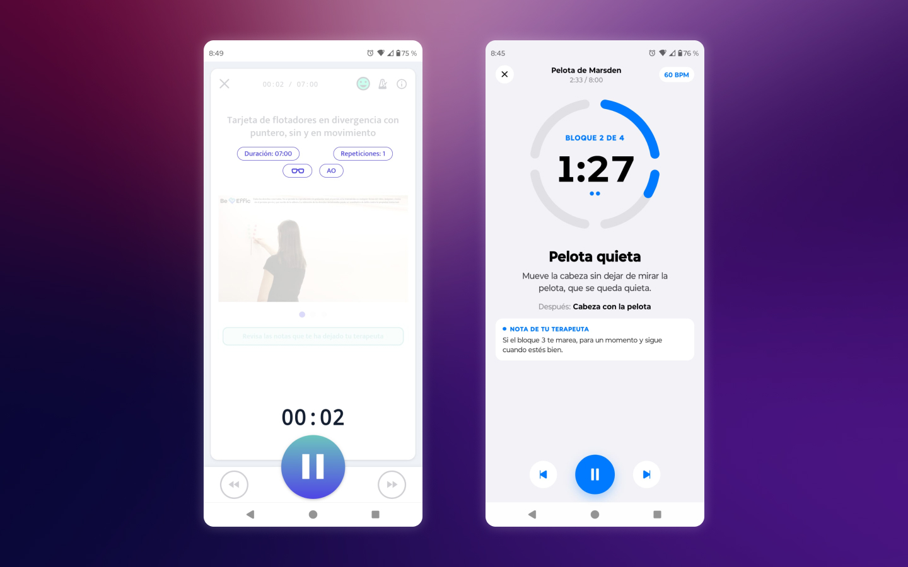
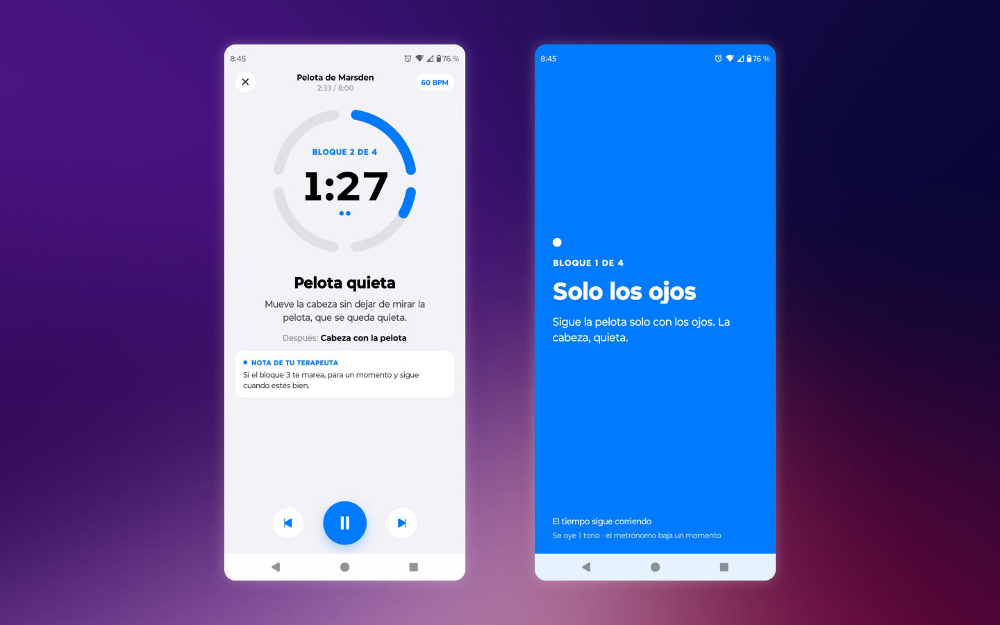
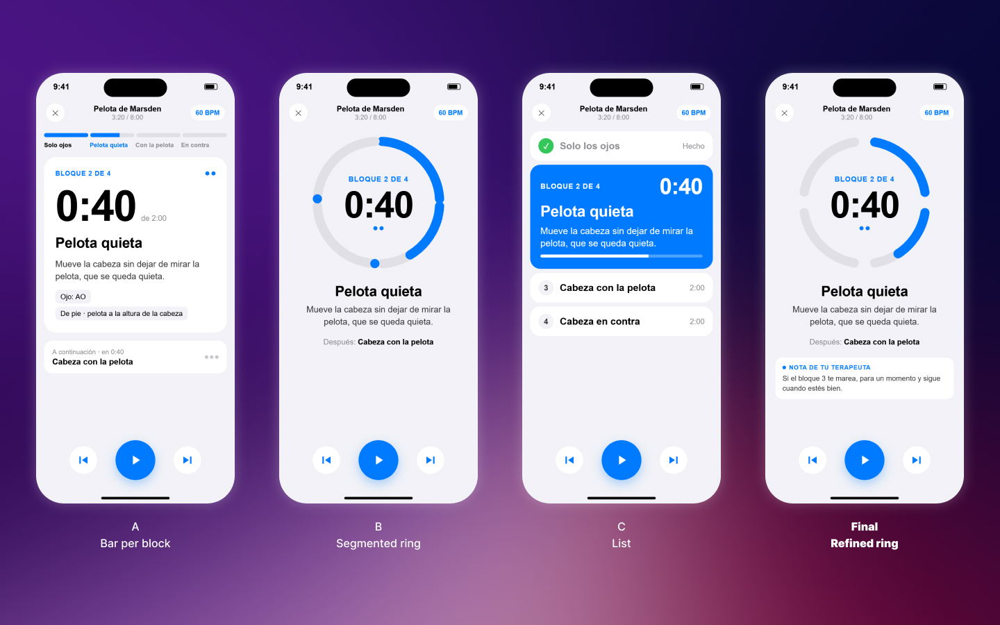
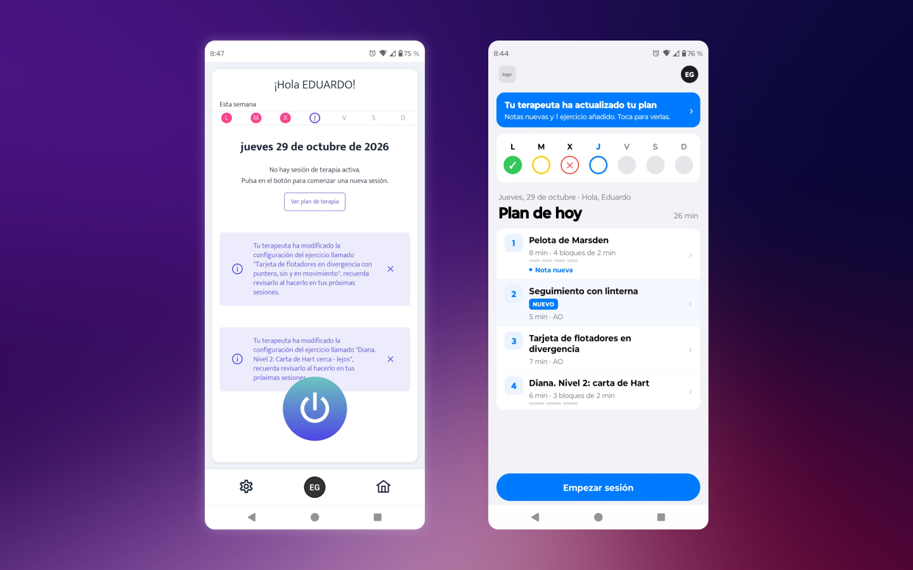
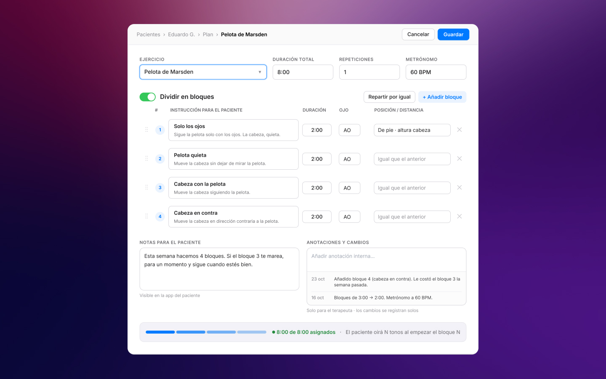

*An unsolicited concept by a patient who uses the app daily. Not affiliated with or endorsed by BeEffic.* · **[View the code on GitHub](https://github.com/EduardoGomezPueyo/visual-therapy-app-redesign)**

## Context

Since July 2026, I've done visual therapy at home with BeEffic's patient app. Every day there's a plan of exercises set by my therapist. I'm a product designer, so I couldn't help noticing where it got in my way.

## The problem

Many of my exercises are timed and split into parts: sitting, then standing; left eye, then right eye. The app shows one timer for the whole exercise and nothing that tells me when to move to the next part. So I end up watching the clock instead of concentrating on the exercise.

## Exercises in blocks, cued by sound

- **Blocks:** each exercise becomes a sequence of timed blocks, each with its own short instruction.
- **Sound:** when a block starts, a chime plays as many times as its number (two tones means block 2). A soft tone warns five seconds before each change, and a different cue marks the end. You know where you are without looking at the screen.
- **Sight, when you do look:** a segmented ring shows the current block and the time left, with the instruction, what comes next and your therapist's note.

## Why a segmented ring

I explored three layouts for the running exercise: a bar per block, a segmented ring, and a list readable from a distance. None was as clear as the ring, so I refined it until each block's arc stood apart from the next. I also dropped a volume slider from the settings, because the phone's own volume already does that job.

## The rest of the flow

Today's plan now shows every exercise with its duration and blocks. New exercises and notes are marked where they apply, instead of arriving as long notifications. A mood check-in before the session and a short self-assessment after it become a report for the therapist.

## The therapist's half

The blocks have to come from somewhere, so I designed the other half too. It's an editor where the therapist splits an exercise into blocks, writes the instruction for each one, and leaves notes the patient sees in the app. It checks that the blocks add up to the total time and logs every change. This part is a design only.

## How I made it

I sketched the idea in Figma, iterated on it in Claude Design until it was presentable, and built a working prototype in Expo (React Native) with Claude Code. The prototype has real sound cues and a metronome playing underneath them. One known gap: the timer runs in the app, so cues aren't reliable with the phone locked. A production version would need a background service.

## What I heard back

I showed it to my therapist, and she was thrilled. She'd heard the same complaint from other patients. I also shared it with the app's developer, who'd heard it too.

## Reflection

This is the only project where I'm the user. That made the problem easy to see and hard to judge, because what bothers me might not bother everyone. Hearing the same complaint from my therapist and from the developer told me it wasn't just me. Next, I'd test the sound cues with other patients, especially how many tones are too many to count in the middle of an exercise.
